# lab_3

## Часть 1. Запуск вручную (контейнеры `docker run`)

```bash
#создадим контейнер redis
docker run -d --name redis redis
```

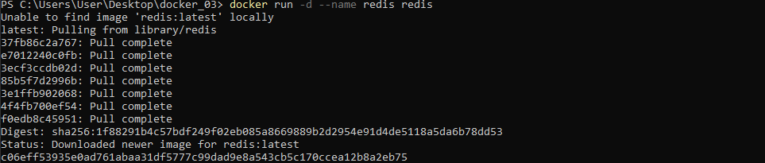

Контейнер создан в фоновом режиме с именем `redis`. Образ `redis:latest` был автоматически скачан из Docker Hub.

```bash
#проверим, что контейнер создан
docker ps
```

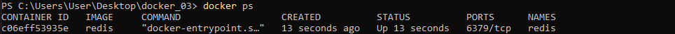

Контейнер `redis` в статусе `Up`, слушает порт `6379/tcp`.

```bash
#создадим приложение rocketcounter
docker run -d --name rocketcounter --link redis:redis -p 8085:5000 rotorocloud/rocket-counter
```

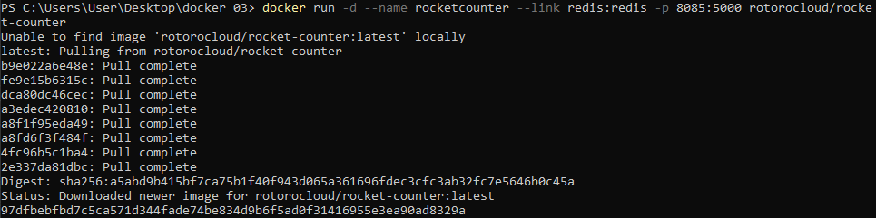

Создаем приложение из образа `rotorocloud/rocket-counter`, связываем его с `Redis` через `--link` и публикуем на порту `8085`. Флаг `--link redis:redis` связывает контейнер `rocketcounter` с контейнером `redis`.

```bash
#проверим
docker ps
```

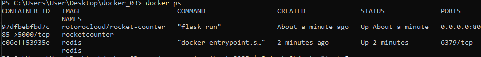

`--link` исторически устарел. В этой части используем его намеренно, чтобы увидеть ручную связку. В Compose он не нужен.

Проверим, что приложение отдаёт HTML-страницу: 

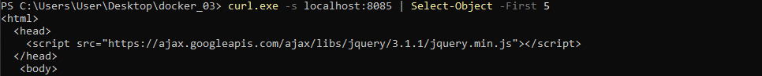

Откроем ее на `localhost`:

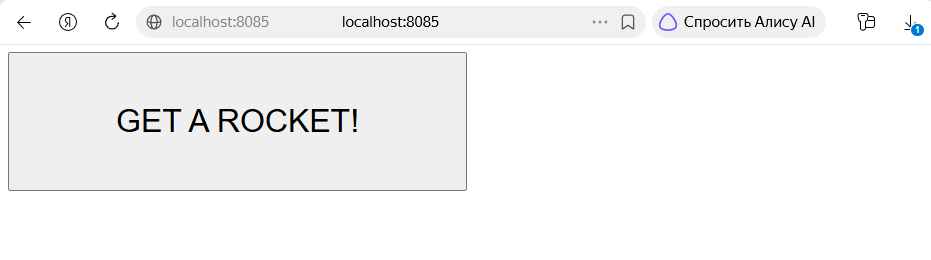

Понажимаем на кнопку `GET A ROCKET` и убедимся, что счетчик работает:

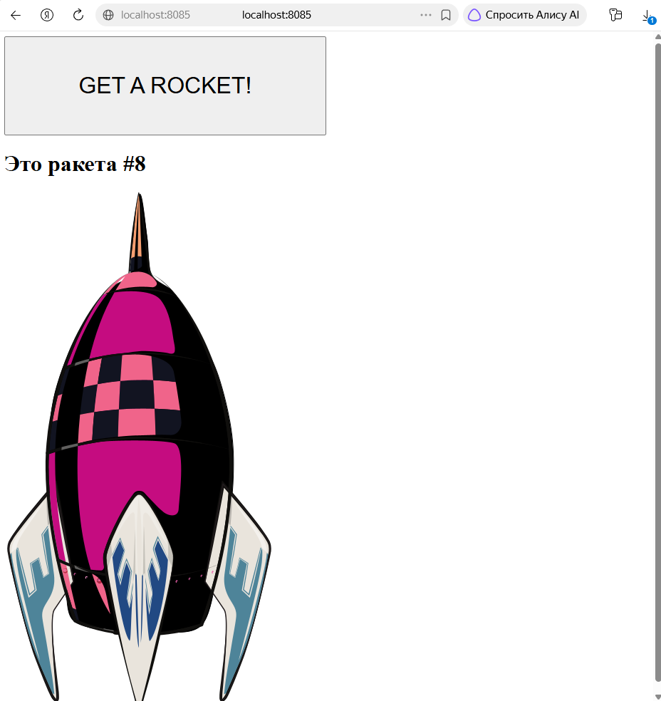

Счётчик растёт, значит приложение успешно работает и сохраняет данные в `Redis`.

```bash
#остановим контейнеры
docker stop rocketcounter redis
#удалим контейнеры
docker rm rocketcounter redis
#посмотрим
docker ps -a
```

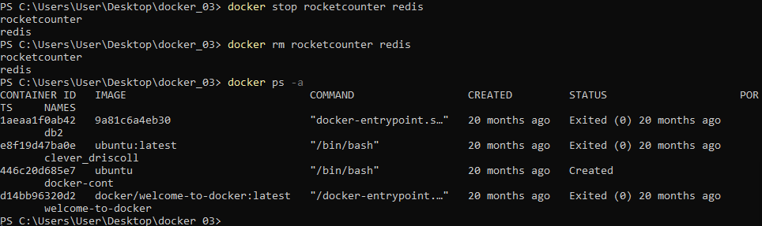

Остались только старые контейнеры - все оки.

## Часть 2. Описание стека в `docker-compose.yml`

```bash
#создадим папку rocketcounter
mkdir rocketcounter
#перейдем в нее
cd rocketcounter
```

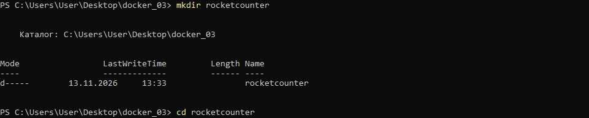

Создадим в ней файл:

```bash
notepad docker-compose.yml
```

Запишем туда текст:

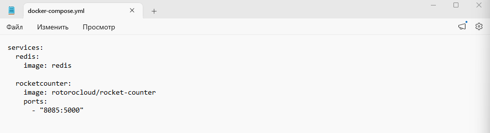

Тут мы описали требования для стека. В файле описаны два сервиса: `redis` (база данных) и `rocketcounter` (приложение). Связь между ними обеспечивается автоматически: Compose создаёт общую сеть для проекта. 

```bash
#запустим стек
docker compose up -d
```

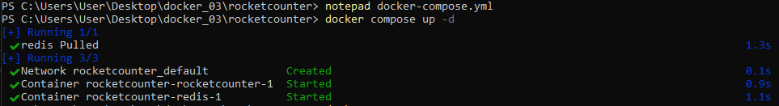

```bash
#проверим
docker compose ps
```

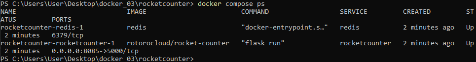

Откроем `localhost` и понажимаем на кнопочку `GET A ROCKET`:


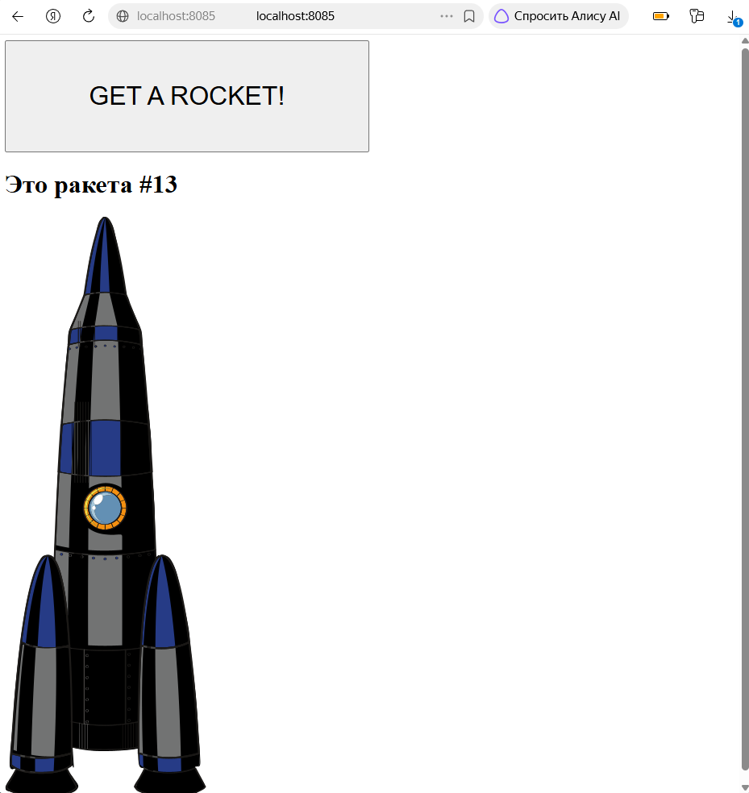

Счетчик работает, все корректно.

## Часть 3. Масштабирование приложения

```bash
#откроем файл
notepad docker-compose.yml
```

И изменим порт:

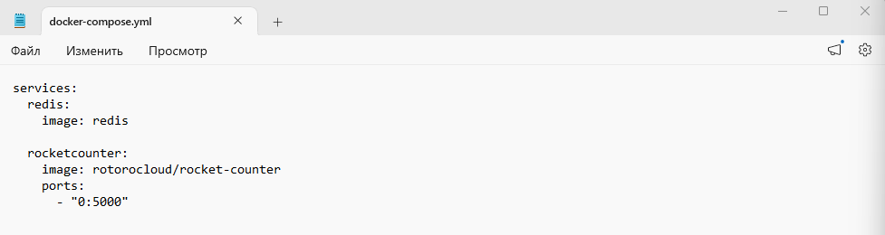

Таким образом, хост выберет свободный порт автоматически.

Применим изменения и запустим 2 экземпляра:

```bash
docker compose up -d --scale rocketcounter=2
```

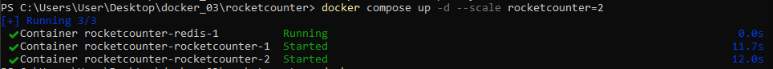

```bash
#посмотрим
docker compose ps
```

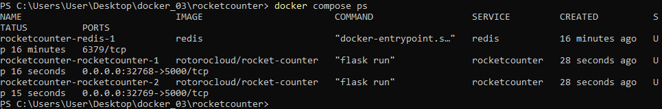

Docker автоматически выдал разные свободные порты для двух копий приложения.

Зайдем на `http://localhost:32768` и понажимаем на кнопочку:

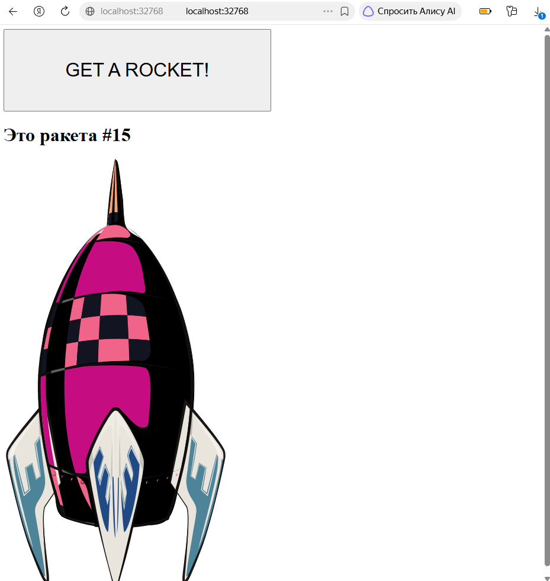

Остановимся на 15.

Затем зайдем на `http://localhost:32769` и увидим, что счетчик начинается как раз с 15:

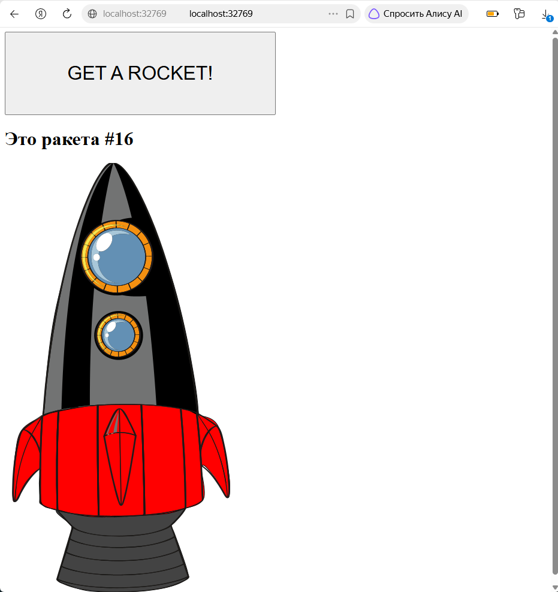

Счетчик для них общий (хранится в одном `Redis`). Масштабирование работает.

## Часть 4. Полное уничтожение стека

Выполним команду для полной очистки окружения, созданного через Docker Compose:

```bash
docker compose down -v
```

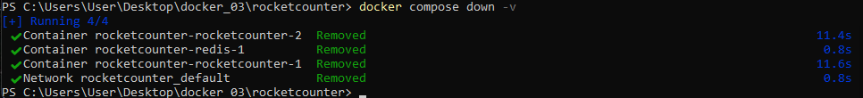

Проверим, что ничего не осталось:

```bash
#посмотрим
docker ps -a
```

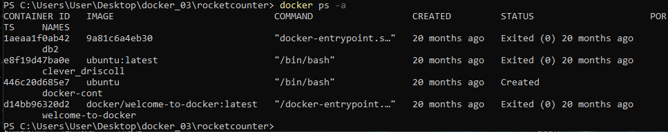

Пусто, остались только старые контейнеры.

```bash
#посмотрим сети
docker network ls
```

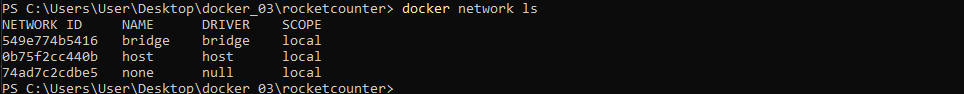

Тут тоже только старые. Очистка выполнена.

## Вопросы

Зачем в Ч.1 использовался `--link` и почему в Compose он не нужен?
- `--link` исторически устарел. В этой части используем его намеренно, чтобы увидеть ручную связку. В Compose он не нужен.
При запуске `docker run`, у контейнеров нет общей связи. Чтобы один контейнер мог обратиться к другому по имени, как раз и применяли `--link`. Это нужно было для упрощения обращения между контейнерами.
В Compose он не нужен, потому что Docker Compose сам создает сеть для проекта и перемещает туда все сервисы, зависимости по порядку запуска оформляются через `depends_on`, а не через `--link`.

Чем отличается `image` от `build` в Compose?
- параметр `image` указывает готовый образ Compose либо берёт его локально, либо скачивает. Параметр `build` указывает как собрать образ локально путь к папке с конкретными параметрами сборки, Compose запускает `docker build` и использует полученный образ.

Почему нельзя масштабировать сервис с публикацией фиксированного порта на одном хосте? Перечислите способы обойти это ограничение.
- потому что при масштабировании все реплики сервиса попытаются занять один и тот же порт на хосте, а порт на хосте может слушать только один процесс (контейнер). Первый запуск займёт порт, вторая и последующие реплики упадут с ошибкой.
Обойти это можно, например, отказаться от публикации порта и обращаться к сервису по имени внутри сети Compose или использовать диапазон портов («8000-8002:80»), из которого Compose выдаст каждой реплике свой порт.

Что делает `docker compose down -v` и чем отличается от `down без -v`?
- команда `docker compose down` останавливает и удаляет контейнеры и сети проекта, но оставляет именованные тома нетронутыми — данные сохраняются. Флаг `-v` дополнительно удаляет именованные тома, объявленные в конфигурации Compose, что приводит к полной потере данных в них. Поэтому `down -v` применяют в сценариях, когда требуется полностью сбросить состояние окружения.

Как в Compose обеспечивается сетевое имя сервиса для обращения из другого сервиса?
- в Docker Compose сетевое имя сервиса для обращения из других сервисов обеспечивается за счёт общей пользовательской сети и встроенного DNS Docker. Имя сервиса, указанное в секции `services` файла `docker-compose.yml`, автоматически регистрируется во внутренней DNS‑службе. Это позволяет сервисам обращаться друг к другу по имени без необходимости использовать устаревший `--link`. Для корректной работы сервисы должны находиться в одной сети; при масштабировании сервиса имя резолвится в IP‑адреса всех реплик.
